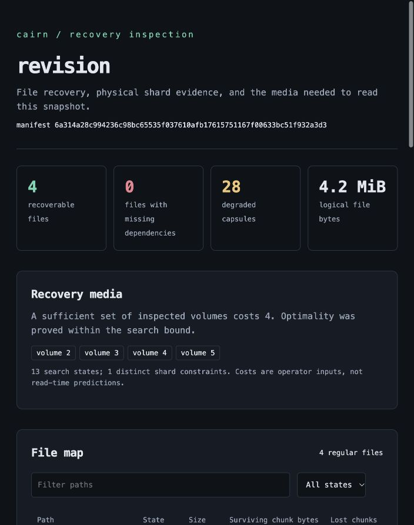

# cairn

An offline archive and recovery tool written in Nim. Directory trees become
content-addressed, erasure-coded capsules. A damaged archive can explain which
files survive, identify the media needed to read them, and recover without a
central object index.

The question behind it: **if a drive disappears and several remaining files
silently change, can I still tell exactly what is recoverable?**

## Run the failure path

```sh
git clone https://github.com/Aneesh495/cairn.git
cd cairn
make build
make demo
```

The demo archives two revisions of a synthetic instrument dataset, removes two
volumes, generates an offline damage report, repairs the archive, and compares
the restored file bytes. Its JSON result names every output, including
`.runtime/demo/report.html`.

`make build` uses an installed Nim 2.2.6 or newer. If none is available, it
downloads a checksum-pinned official Nim 2.2.12 into `.toolchain/`. Automatic
setup needs Python 3.12+, `curl`, a C compiler, and network access once. The
compiled executable needs only the POSIX host runtime. No package registry,
database, service, or account is used at runtime.

If Nim is already installed, `make NIM=nim build` needs no Python or download.
See [building](docs/development.md) for offline setup and platform details.

## Archive a directory

```sh
./bin/cairn init /mnt/archive
./bin/cairn backup /mnt/archive ./dataset run_001 --exclude 'cache/'
./bin/cairn check /mnt/archive run_001
./bin/cairn restore /mnt/archive run_001 ./recovered
```

Repository and restore destinations must be new. The source and repository
must be disjoint. Restore verifies file hashes inside a private staging tree
before publishing the destination. It preserves ordinary file bytes, directory
structure, permission bits, modification times, and confined relative links.

## What is inside

| Mechanism | Responsibility |
|---|---|
| Normalized gear chunking | Stable streaming boundaries and cross-snapshot deduplication |
| Domain-separated SHA-256 | Independent identities for file content and manifests |
| Systematic Reed-Solomon | Any k validated shards reconstruct a k+m capsule |
| Self-describing packets | Geometry, content identity, lengths, codec, CRC32C, and shard digest travel with each shard |
| Replicated snapshot roots | One valid root copy identifies a complete, independently readable manifest |
| Damage dependency map | Physical shard evidence becomes per-file recovery status and missing ranges |
| Recovery media planner | Weighted multicover with bounded exact search and an explicit optimality flag |
| Correlated loss envelope | Exhaustive volume-loss combinations within an explicit case budget |
| Evidence-bound repair | Exact before/after digests, stale-plan rejection, and byte/packet budgets |
| Honest salvage | Verified complete files and separately named fragments with offsets |
| Mark-and-sweep collection | Exact archive preimage checked under the writer lock before deletion |
| Streaming transport | Per-frame checksums and a final transcript prevent partial bundle publication |

The default geometry is four data shards and two parity shards. Each capsule
can lose any two positions. The six volume directories initially live on the
same filesystem. **That arrangement does not protect against losing the entire
device.** Place volumes on independent storage or retain detached copies when
device loss is the concern. Assembly reads surviving detached volumes into a
new repository.

## Inspect damage before changing anything

```sh
./bin/cairn simulate /mnt/archive run_001 --unavailable 0,1
./bin/cairn plan /mnt/archive run_001 --costs 8,5,3,2,1,9
./bin/cairn envelope /mnt/archive run_001 --max-loss 3
./bin/cairn report /mnt/archive run_001 ./recovery.html
./bin/cairn repair /mnt/archive run_001 > repair.json
./bin/cairn apply-repair /mnt/archive repair.json
```

The report is a self-contained local HTML file with path filters, shard
heatmaps, recovery media selection, and failure cases. It makes no network
requests.



## Recover from surviving media

```sh
./bin/cairn scan /media/surviving-volume
./bin/cairn assemble ./rescued /media/volume-2 /media/volume-3 /media/volume-4 /media/volume-5
./bin/cairn restore ./rescued run_001 ./recovered
```

If some data is irrecoverable but the manifest survives:

```sh
./bin/cairn salvage ./rescued run_001 ./salvaged
```

Complete files go under `complete/`. Incomplete files become `.part` fragments
under `fragments/`, with original offsets and explicit missing ranges in
`salvage.json`. Missing bytes are never replaced with guessed data.

If all root records are gone, `discover-snapshots` scans manifest capsules.
`recover-root` republishes one explicitly selected manifest after validating
its file content. Discovery can find deliberately forgotten snapshots too.

## Verify it

```sh
make verify
make verify-evidence
make replay-evidence
```

Verification runs checked debug and release suites, deterministic randomized
campaigns, actual subprocess crashes, every zero-, one-, and two-volume loss
subset for the default geometry, and an independent Python decoder. The decoder
implements its own field arithmetic, matrix inversion, packet reader, SHA-256
checks, compression reader, and chunk-boundary rules.

The [local receipt](evidence/local/acceptance.json) is bound to a source manifest.
Raw command outputs and a synthetic archive fixture are retained beside it.
`make replay-evidence` independently decodes that retained fixture. See
[verification](docs/testing.md) for the exact workload and its limits.

## Read the implementation

- [Architecture and state transitions](docs/architecture.md)
- [Byte-level format specification](docs/format.md)
- [Recovery algorithms and guarantees](docs/recovery.md)
- [Operator workflows](docs/operations.md)
- [Developer guide](docs/development.md)
- [Verification and regression ledger](docs/testing.md), [observed bugs](docs/bugs.md)
- [Threat model and filesystem boundaries](docs/security.md)
- [Benchmark method](docs/performance.md)
- [Design decisions](docs/decisions/0001-capsules.md)

Cairn targets POSIX macOS and Linux. It does not encrypt archives, authenticate
an untrusted writer, preserve ACLs/xattrs or hard-link identity, or provide
atomic snapshots of live databases. SHA-256 detects corruption. Keep a separate
copy of irreplaceable data and quiesce mutable applications before acquisition.

MIT licensed. See [LICENSE](LICENSE).
