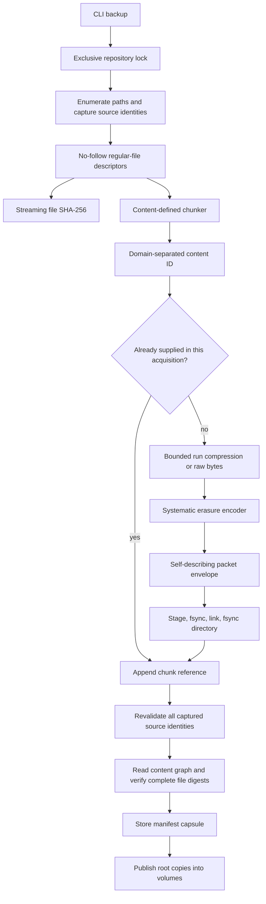
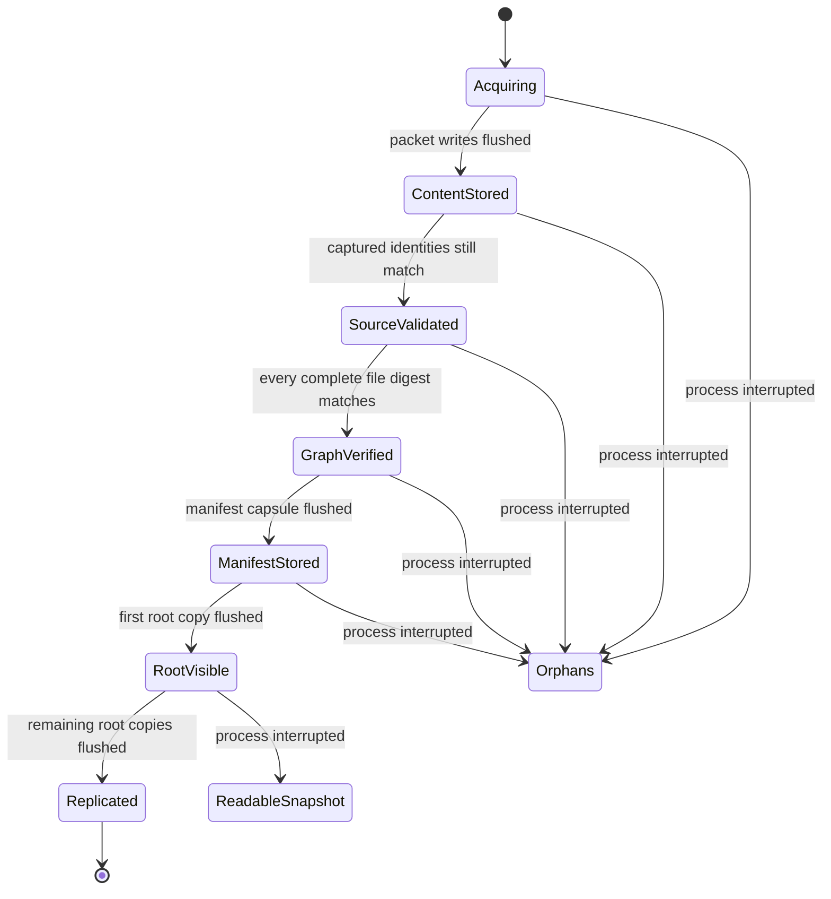
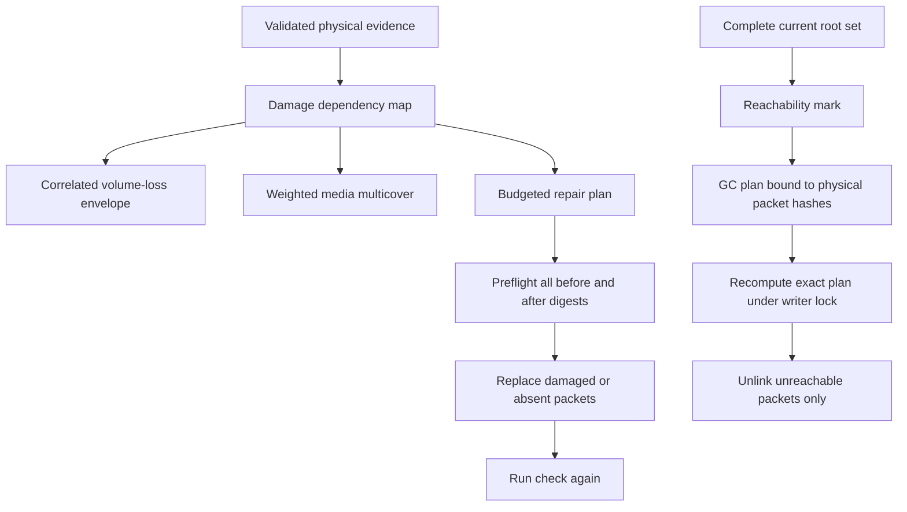

# Architecture

Cairn has three kinds of state: immutable content capsules, small replicated
snapshot roots, and ephemeral plans or staging files. There is no authoritative
object index, daemon, catalog database, or incremental manifest chain.

## Acquisition path



`backup.nim` owns acquisition. `chunker.nim`, `compression.nim`, and
`erasure.nim` do not know about filesystems. `capsule.nim` defines the integrity
boundary. `store.nim` handles placement and validated retrieval.

Acquisition records device, inode, size, mode, mtime, and ctime before reading.
A no-follow descriptor must match that record after open and after reading.
Every selected path is checked again before publication. Directory timestamps
detect ordinary additions, removals, and replacements during traversal.

This detects ordinary changes; it is not a filesystem snapshot primitive.
Application quiescence or an externally created filesystem snapshot remains
necessary for coherent live database backups.

## Repository layout

```text
archive/
  .lock                         permanent advisory-lock inode
  config.json                   immutable repository configuration
  volumes/
    00/
      volume.json               configuration replica and position
      refs/
        run_001.json            checksummed snapshot root
      objects/
        ab/
          ab...64-hex...cd.cap   one validated shard
    01/
    ...
```

Each object has at most one packet in each position. An object's packet path is
derived from a validated content ID and volume index. Filenames are useful for
normal lookup, but a capsule header carries enough information for independent
discovery after renaming or detaching the packet.

A manifest is a complete tree. Files reference content capsules directly.
Repeated bytes can be shared across files and snapshots. Deleting one snapshot
does not alter another manifest or require rebasing an incremental chain.

Configuration is copied into every volume so assembly can recover after losing
the top-level configuration and lock file. A valid foreign volume identity is
rejected. An unreadable identity makes that volume unavailable until repaired.

## Read and restore path

```mermaid
flowchart LR
    R[Snapshot label] --> Q[Validate surviving root copies]
    Q --> M[Recover manifest capsule]
    M --> T[Validate complete tree and link graph]
    T --> C[Resolve file chunk references]
    C --> P[Validate packet headers and shard digests]
    P --> K{At least k distinct valid shards?}
    K -->|no| X[Explicit unrecoverable error]
    K -->|yes| D[Invert selected generator rows]
    D --> E[Check padding and every supplied coding equation]
    E --> Z[Bounded decompression]
    Z --> H[Check content ID]
    H --> F[Stream into private restored file]
    F --> V[Check complete file digest]
    V --> S[Flush staged tree]
    S --> A[Publish new destination directory]
```



The manifest root is a dependency of every pathname and layout. The damage map
therefore distinguishes surviving chunk bytes from complete recoverable files.
If the metadata itself is lost, filenames and offsets cannot be inferred from
data capsule contents alone.

Restored regular files are installed before symbolic links. Directories remain
private and writable until their children are complete. Directory metadata is
restored from leaves to root, using descriptors opened before restrictive
permission bits are applied.

## Publication state machine



Before a root appears, interrupted work is unreachable content. GC can reclaim
it after checking the complete current root set. After one valid root appears,
the manifest and its content graph already exist. An interrupted replication
may leave fewer root copies, but it cannot legitimately expose a partial file
graph. Reference repair fills the missing copies.

## Concurrency contract

All high-level operations use one permanent `.lock` inode:

| Lock | Operations |
|---|---|
| Shared | restore, salvage, inspect, check, stats, history, search, planning, export |
| Exclusive | backup, repair application, root recovery, forgetting, GC application |
| New private repository | initialization, assembly, bundle import |

Locks are nonblocking. A conflicting operation returns status 5. `flock` releases
the lock when a process dies, so stale PID files and timeout guesses are absent.
The inode must never be unlinked while a repository is in use.

Low-level storage helpers deliberately do not acquire nested locks. Embedders
must hold the corresponding lock around a multi-step low-level operation.
High-level APIs in `backup`, `restore`, `query`, `repair`, `gc`, and `bundle`
provide that boundary. Never mix raw filesystem mutation with running readers.

## Analysis and mutation



Planning never changes content. Repair preflights the entire action list before
its first write. GC recomputes the complete plan before its first deletion.
Both operations can be interrupted safely. A partly applied saved plan becomes
stale; generate a fresh plan rather than weakening its preconditions.

## Resource model

- Source reads use a 128 KiB buffer and one bounded chunk accumulator
- A complete manifest and the selected path identities are held in memory
- Object encode/decode buffers scale with `object size * total shards / data shards`
- Repair caches only the current capsule's replacement shards
- Metadata nesting, path depth, object lengths, entries, and chunk references have explicit caps
- Planner state and failure-case counts have explicit operator budgets
- Bundle transport reads one bounded frame at a time
- The HTML view caps displayed file and capsule rows while JSON retains the full report

Large shard counts, large manifests, and a one-data-shard geometry can require
substantial memory. The defaults use 16/64/256 KiB chunk bounds and a 4+2 geometry.
The hard format caps are safety limits, not recommended operating sizes.
