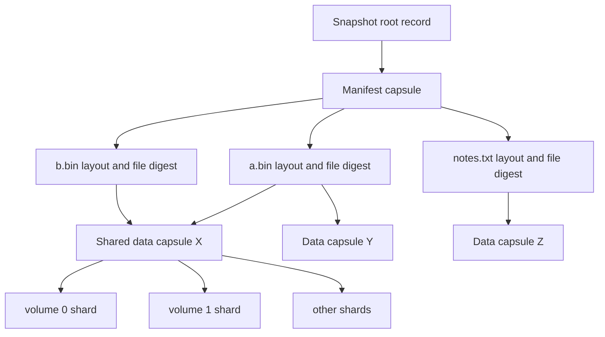

# Recovery model and algorithms

Recovery begins with physical evidence, then follows logical dependencies.
Counts alone are never a substitute for reconstructing an object and checking
its content identity.

## Integrity layers

| Layer | What it detects | What it does not establish |
|---|---|---|
| Header CRC32C | Torn or accidentally changed header fields | Writer authenticity |
| Shard SHA-256 | Changed shard payload | Correct coding relationship to other shards |
| Coding-equation check | A surplus shard inconsistent with decoded bytes | Identity of a malicious writer |
| Domain-separated object SHA-256 | Incorrect reconstructed or decompressed content | Authenticity of the selected snapshot root |
| Complete file SHA-256 | Wrong chunk ordering, lengths, or file assembly | A coherent live application snapshot |
| Reference checksum | Accidental root-record edits | Authorization to create or replace a root |

The normal accidental-damage case converts invalid packets into erasures.
Different capsules may have different unavailable positions. The redundancy
margin is therefore per capsule, not a single repository-wide disk count.

An adversary able to rewrite packet hashes and roots is outside the integrity
model. A rechecksummed bad parity shard is still rejected by the complete
capsule algebraic check. Cairn does not claim to identify and correct arbitrary
malicious shard forgeries automatically.

## Damage dependency map



Losing capsule X affects both `a.bin` and `b.bin`, even if only one physical
object disappeared. The report records this reverse dependency list. The same
chunk can occur more than once in one file; logical byte accounting counts
each occurrence, while physical object accounting counts the object once.

Object states are:

- **Healthy:** every expected position validates and reconstruction succeeds
- **Degraded:** at least k positions validate and reconstruction succeeds, with some positions absent or corrupt
- **Lost:** fewer than k positions remain, or the reconstructed capsule fails an integrity check

`check` defaults to full object reconstruction and complete file digest checks.
`check --fast` skips object reconstruction and file digest verification. It is
a quick shard-level inspection and its JSON explicitly marks that limitation.

The manifest capsule is a dependency of every file, including empty files.
`recoverable_chunk_bytes` can describe useful surviving fragments even when
the corresponding complete file cannot be restored. It must not be presented
as the byte size of complete recoverable files.

## Recovery media selection

Assign each volume a nonnegative integer cost. It can represent an operator's
effort, shipping expense, mount inconvenience, or a relative preference. It is
not a measured latency estimate.

For each required object, construct a bitmask of volumes containing valid
shards. A feasible plan selects at least k positions in every mask. Equal
mask/threshold constraints are collapsed. This is a weighted multicover
problem with at most 32 volume variables.

The planner first removes expensive redundant media from the full set to obtain
a feasible upper bound. It then performs branch-and-bound search:

1. Process volumes in ascending cost, then index order
2. Reject a branch whose selected cost already exceeds the best solution
3. Reject a branch that cannot fill a constraint from its remaining positions
4. For each unsatisfied constraint, sum its cheapest remaining required positions
5. Use the maximum of those sums as an admissible lower bound
6. Explore include and exclude branches within the explicit state budget

The maximum per-constraint bound is valid because one selected volume can help
several constraints. Adding all such bounds would double count shared choices
and could incorrectly prune the optimum.

If the search finishes, `optimal` is true. If it hits the state budget, the
existing plan remains feasible, `optimal` is false, and `lower_bound` states
what was proved. A plan is never called optimal merely because it looks cheap.
If an object is already lost, a complete recovery plan is infeasible.

The test suite compares randomized small instances with an independently
written exhaustive subset oracle.

## Correlated media loss

`envelope` evaluates additional unavailable-volume subsets against a frozen
damage map. A case removes every shard on each selected physical volume. It
then recomputes capsule and complete-file survivability.

For a healthy n=k+m archive, every subset of at most m lost positions should
survive. Existing packet damage can reduce that margin. A single already
missing shard can make some further m-volume combinations destructive while
other combinations still survive.

The enumeration includes the zero-additional-loss case and groups results by
loss cardinality. It reports:

- Cases inspected and damaging cases at each level
- Worst number of lost files
- Minimum bytes belonging to complete recoverable files
- The smallest observed damaging loss count
- Whether every requested case was enumerated

`enumeration_complete=false` is a substantive limitation. An unobserved failure
outside the case budget is not evidence of resilience. This tool models the
inspected layout; it does not estimate hardware lifetimes or assume statistical
independence between drives.

## Repair planning

Repair operates only on capsules that can be fully reconstructed and verified.
It never guesses missing content. Lost objects remain in `lost_objects`.

A plan orders degraded objects by remaining shard margin, then dependent-file
count and content ID. For each missing or corrupt position it records:

| Field | Meaning |
|---|---|
| `id`, `kind`, `volume` | Exact capsule and target position |
| `before` | Current physical file SHA-256, or literal `missing` |
| `after` | SHA-256 of the complete replacement packet file |
| `bytes` | Exact replacement file length |

Byte and packet budgets select a deterministic prefix of eligible actions.
Deferred actions remain explicit. The ordering is a useful repair heuristic;
it is not claimed to solve a global risk optimization problem.

Application holds the exclusive lock and checks every action before the first
write. It verifies repository identity, manifest identity, target preimages,
replacement content, duplicate targets, geometry, and exact lengths. A stale
target causes the whole preflight to fail.

After preflight, packets are replaced through the durable file-publication
path. Root copies are repaired from the surviving agreed reference. If the
process dies between actions, completed replacements are valid immutable
packets. Generate a new plan to continue.

Run `check` after repair. A bounded application with deferred packets returns
status 4. A plan containing lost objects returns status 3. Status 0 describes a
fully applied plan without known deferred or lost objects in that snapshot.

## Salvage

Salvage requires a readable manifest. It cannot infer filenames or offsets from
isolated data capsules after losing all relevant metadata.

```text
salvaged/
  complete/sub/file.bin
  fragments/<SHA256(original_path)>/0.part
  fragments/<SHA256(original_path)>/65536.part
  salvage.json
```

For each original file, `salvage.json` records size, expected digest, complete
or partial status, and a range list. Each range contains offset, length, content
ID, fragment path when available, and the error when unavailable.

A fully readable file is assembled, hashed, and installed under `complete/`.
Its temporary fragments are removed. Incomplete files retain only validated
fragments; there is no sparse placeholder with zero-filled gaps. Symlink
targets are reported as metadata rather than installed into a partial tree.

Destination I/O errors abort salvage and remove its private staging tree.
They are not classified as missing archive data. A real file-size-limit
regression test protects this distinction.

## Root discovery and detached assembly

Every manifest is itself a content capsule. `discover-snapshots` examines
discoverable object IDs, recovers manifest candidates, and reports their labels
and current content loss. It changes nothing.

`recover-root` takes one manifest ID, validates its complete file graph, and
publishes its original label. An existing label prevents replacement. This
operation can resurrect a deliberately forgotten snapshot while its manifest
and data capsules remain, which is why it is explicit.

`assemble` reads independent volume directories into a new private repository.
Configuration replicas must agree. Valid packets are placed by header identity
rather than their input filenames. Corrupt packets are reported and skipped;
conflicting valid packets or roots abort assembly. The result reports readable
and incomplete snapshots separately. Inputs are never moved or modified.
